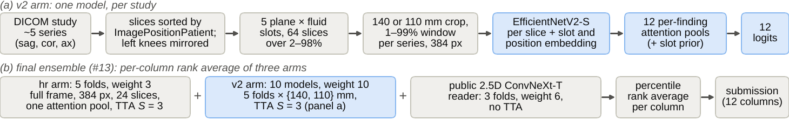
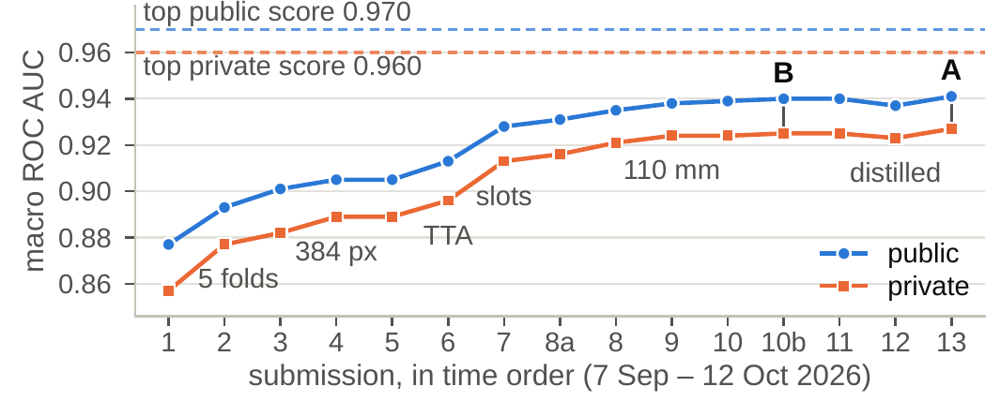

# RSNA Knee Abnormality Detection

Our entry to the Kaggle **RSNA Knee Abnormality Detection** challenge (2026). The task is to predict
12 findings per knee MRI study (ACL, MCL, medial and lateral meniscal tear, medial, lateral and
patellofemoral osteoarthritis, effusion, synovitis, Baker's cyst, contusion, fracture), scored by
macro ROC AUC. Only 58 of the 4,407 training studies carry radiologist labels, so the models were
trained on labels that LLMs extracted from the radiology reports.

**Paper:** [paper.pdf](paper.pdf) is a 2-page write-up of the approaches, the validation protocol,
every submission and the lessons ([LaTeX source](paper.tex)).



## Results

| | Public | Private |
| --- | --- | --- |
| **Final A: sub #13** (own ensemble + public 2.5D reader) | 0.941 | **0.927** |
| Final B: sub #10b (own models only) | 0.940 | 0.925 |
| Top of the leaderboard | 0.970 | 0.960 |

We finished **3,011th of 6,299** teams on the private leaderboard (3,163rd on the public one), a
mid-table result. All 15 submissions scored 0.014–0.020 lower on private than on public and kept
their order, and the first-choice final was also our best private score. The validation held up;
the gap to the top came from the approach (data, labels, views), not from overfitting the public
board.



| Sub | Change | Public | Private |
| --- | --- | --- | --- |
| 1 | EfficientNetV2-S, 224 px, fold 0 | 0.877 | 0.857 |
| 2 | 5-fold ensemble | 0.893 | 0.877 |
| 4 | + 384 px arm | 0.905 | 0.889 |
| 6 | + slot-phase TTA (S = 3) | 0.913 | 0.896 |
| 7 | + v2 slot arm (fold 0) | 0.928 | 0.913 |
| 8 | v2 arm, 5 folds | 0.935 | 0.921 |
| 9 | + five 110 mm v2 models | 0.938 | 0.924 |
| 10b | 224 px arm dropped, 110 mm crop bug fixed | 0.940 | 0.925 |
| 13 | + public 2.5D ConvNeXt-T reader (weight 6) | 0.941 | 0.927 |

## Approach

- **Labels.** A soft consensus of three public LLM-extracted report-label tables (stevenleehans v2,
  pilkwang v2, lixin73; CC0), weighted per cell by teacher agreement and certainty, with the 58 gold
  studies at weight 3.
- **v2 arm (the main model).** Each series is centre-cropped to 140 or 110 mm using `PixelSpacing`,
  windowed at its own 1st–99th percentiles and resized to 384 px. Slices are ordered by
  `ImagePositionPatient` and left knees are mirrored. Five plane × fluid slots (64 slices at test
  time) feed a shared EfficientNetV2-S with 12 per-finding gated-attention pools.
- **hr arm.** An older full-frame 384 px model (24 slices, one attention pool): weaker alone, but
  different.
- **Public reader.** goodpjw2008's 2.5D ConvNeXt-T reader (Apache-2.0), ported verbatim. Its fold
  split was re-derived and proven before its out-of-fold predictions were trusted.
- **Ensemble.** A per-column percentile-rank average with weights hr : v2 : reader = 3 : 10 : 6
  (15 own models plus 3 reader checkpoints) and slot-phase TTA with S = 3. It runs in about 5 h on
  Kaggle's T4.

## Validation

Every change was gated on two checks: stitched 5-fold out-of-fold (OOF) macro AUC against the LLM
labels, and AUC on the 58 gold studies, each scored by the fold that held it out. Gates were fixed in
advance: a new member had to add at least +0.003 OOF without lowering gold. A submission needed about
+0.005 of expected gain or served as a pre-registered calibration. The finals were picked by local
validation, and nothing was fitted to the public board.

Two results did not transfer to the board. Distillation on OOF-derived targets looked +0.004 better
locally, but its targets leak the held-out folds, so it scored no better (public and private) and the
distilled-only entry scored lower. The validated public reader added +0.0069 OOF but only +0.001
public and +0.002 private.

## Ruled out

Each of these was measured and closed (Table 1 of the paper): 512 px input, 2.5D slice context, a
170 mm crop, CoAtNet-2, second seeds, TTA with S = 5, cross-crop TTA, per-column ensemble weights,
protocol features and distillation.

## Layout

```
paper.tex, paper.pdf      the write-up; figures/ holds its figures and make_figures.py
src/rsna/                 decoding, series ordering, laterality, datasets, models, training, inference
  train_v2.py, infer_v2.py    the v2 arm (with dataset_v2.py and model_v2.py)
  train_hr.py, infer_hr.py    the hr arm
  reader_gpjw.py              the public reader port (Apache-2.0) and its guard
  combine_partial.py          per-column rank average with a per-row fallback
notebook/                 build_notebook_multi.py inlines src/rsna into one offline Kaggle notebook
dev/                      experiment drivers: decoding, label building, OOF fits, TTA, gates, submission
  kaggle/next_*_cmd*          the exact training command line of every model
  pub_reader/, sub13/         validation and integration checks for the public reader
LICENSES/Apache-2.0.txt   licence of the ported reader code
```

## Reproducing

Data and weights are not included, because the competition data cannot be redistributed. The `dev/`
scripts are the original experiment drivers: they assume this machine's paths and a single GPU, so
expect to adjust them.

1. Download the competition DICOMs (about 247 GB) with `bash dev/fetch_raw.sh`. This needs Kaggle
   credentials.
2. Build the cropped caches with
   `.venv/bin/python dev/decode_raw_v2.py data/raw --out data --size 384 --crop-mm 140 --pct 1 99`,
   then again with `--crop-mm 110`.
3. Build the training labels from the public label datasets with `dev/build_consensus_labels.py`.
4. Train fold 0 of each v2 model with its line in `dev/kaggle/next_v2_cmd*`. `v2_effv2s384_lr` is
   line 1 of `next_v2_cmd2`, and `v2_effv2s384_c110` is line 1 of `next_v2_cmd6`. Train the other folds
   with, for example, `CMD_FILE=dev/kaggle/next_v2_cmd6 bash dev/train_folds_v2.sh 1 "1 2 3 4"`. Train
   the hr arm with the `src.rsna.train_hr` command in `dev/train_folds_384.sh`.
5. Fit the ensemble weights on the stitched OOF with `dev/fit_v2_stitched2.py`.
6. Build the offline Kaggle notebook with `notebook/build_notebook_multi.py`. `dev/sub7.sh` packages
   the weights, pushes the kernel and submits; `dev/sub13/run_sub13.sh` is the final submission's
   run script.

## Credits

- RSNA and Kaggle, for the challenge and the data.
- The public LLM report labels by stevenleehans, pilkwang and lixin73 (CC0-1.0).
- The 2.5D ConvNeXt-T reader by goodpjw2008 (Apache-2.0), ported in `src/rsna/reader_gpjw.py` and
  `dev/pub_reader/gpjw_port.py`. The licence text is in [LICENSES/Apache-2.0.txt](LICENSES/Apache-2.0.txt).
- pilkwang's public baseline, whose slot recipe the v2 arm follows, and the maintainers of
  [timm](https://github.com/huggingface/pytorch-image-models).

**Author:** Abdul Samad Zaheer Khan, New York University, ak9943@nyu.edu
